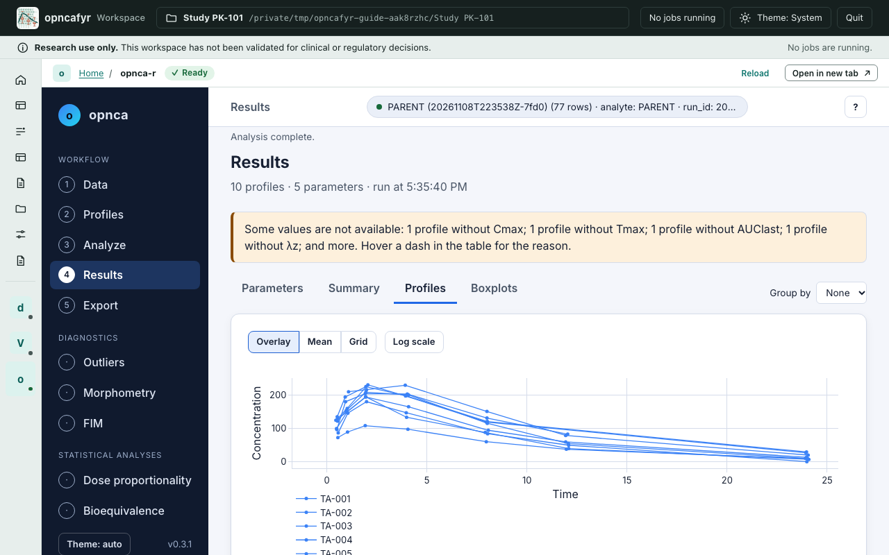
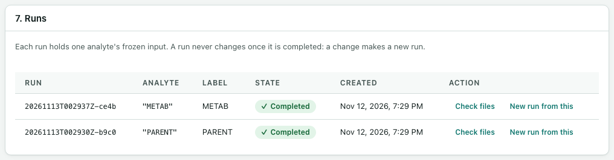

# Analyte runs in opnca-r

A run is one analyte's analysis. It holds a frozen copy of that analyte's rows, your mapping and BLQ choices, the warnings you acknowledged, and later opnca-r's results. opnca-r does every calculation; this app never calculates NCA parameters itself.

Runs are listed in card **7. Runs** on the **Analysis** page, and on **Home** under **Recent runs**.

## The life of a run

| State | What it means | What you do next |
|---|---|---|
| **Preparing** | The run was created with **Start analysis**. | Select **Open in opnca-r**. |
| **Running** | opnca-r is open on this run. | Analyse and save in opnca-r. |
| **Reviewing** | opnca-r saved the run, and the app is replaying it. | When the replay matches, select **Confirm and complete**. |
| **Completed** | The run is sealed. Its files can no longer change. | Publish its tables and figures. |
| **Failed** | The save could not be accepted. | Select **New run from this**. |

## Open the run in opnca-r

1. In **7. Runs**, find the run. It shows the analyte in quotes, its label, its state and when it was made.
2. Select **Open in opnca-r**. The app starts opnca-r on this run's frozen data and shows it inside the app.

Only one run can be open in opnca-r at a time. Opening another run closes the first one.

While opnca-r is open, the strip above it has **Reload** and **Open in new tab ↗**. You can go to other pages and come back; opnca-r keeps your work. The left side lists it under **Apps**.

## Work in opnca-r

opnca-r has its own views along the top: **Data**, **Profiles**, **Analyze**, **Results** and **Export**. Each has a **?** button with help for that view.

- **Data** already holds this run's rows and the column choices you made. You cannot load other data here. Its **Unit labels** show the run's units, marked "set by the launcher"; they cannot be changed here. opnca-r uses them to label results, tables and charts, and converts nothing.
- **Profiles** shows each subject's concentration–time curve and the terminal phase.
- **Analyze** is where you choose what to calculate. The BLQ rules you chose in the app are already set. Choose the metrics (for example the **Standard NCA** preset), then select **Run analysis**.
- **Results** shows the parameters, a summary, profiles and boxplots.
- **Export** is where you save.

Samples you exclude inside opnca-r are recorded, but opnca-r does not record a reason for them. The app adds a warning to the run when that happens.

## Save the run

1. In opnca-r, go to **Export** and find the **Save to run folder** box.
2. Under **Figures in the saved run**, keep **Mean concentration-time figures (linear and log) and their table** ticked if you want the mean figures in reports and decks.
3. Choose the **Time basis** of the mean figures: **Actual time** or **Nominal time**. Nominal time is usually the better choice, because with actual times most time points hold one sample. Also check **Statistic** and **Error**. opnca-r will not save the mean figures until a time basis is chosen.
4. Select **Save to run folder**.

Do not use the **Download** buttons to save a run. The app only accepts what opnca-r writes into the run folder. A save whose unit labels are not the run's is refused, and the run is **Failed**.

The saved run holds opnca-r's script `analysis.R` (its header says "Research use only"), its record of the analysis, the result tables as CSV files with formatted copies in `results/tables/`, and the figures.

## Review and replay

When the save is complete, opnca-r closes and the app checks the saved files. Go back to the **Analysis** page to follow along in card **7. Runs**:

1. "Run … was saved by opnca-r and is ready for review." The run is now **Reviewing**.
2. The app replays the run. It runs the saved analysis script again, on its own copy of the frozen data, and compares every result table with the saved one. Tables that opnca-r says its script does not reproduce, such as bioequivalence tables, are skipped and listed in the replay report. This takes a short while and shows as a job.
3. "Run … replayed and matches its saved results. Confirm it to complete the run."
4. Select **Confirm and complete**. The run is now **Completed** and sealed.

If the replay does not match, the app lists the differences. You can select **Replay again**. A run whose replay does not match cannot be completed or published.

A matching replay shows that the saved script reproduces the saved numbers. It does not show that the analysis choices were right.

## Completed runs never change

A completed run is sealed: every file in it is recorded with its fingerprint and made read-only. To check that nothing has changed since, select **Check files**. The app says "every file matches its recorded hash", or lists what changed, went missing or was added.

To change anything, such as a cleaning step, the mapping, an exclusion or a BLQ rule, make a new run:

- **New run from this** (on a completed or failed run) makes a new run with the same analyte and choices, on the recipe as it is now. If the recipe changed, the checks run again and you may need to acknowledge warnings again.
- Or set up the new run in cards 5 and 6 again and select **Start analysis**.

The old run stays as it was. The new one is linked to it.

## The next analyte

Each analyte is its own run. To analyse a second analyte from the same data:

1. In **5. Analyte and checks**, choose the other analyte and specimen.
2. Select **Run checks**, and acknowledge its warnings.
3. In **6. Start analysis**, check the label and the BLQ choices, then select **Start analysis**.
4. Open, save, replay and complete the new run as above.

The two runs share the recipe, but each has its own frozen rows, script and results. Rows of one analyte never appear in the other's run.

Next: [Publishing tables and figures](publishing.md).
