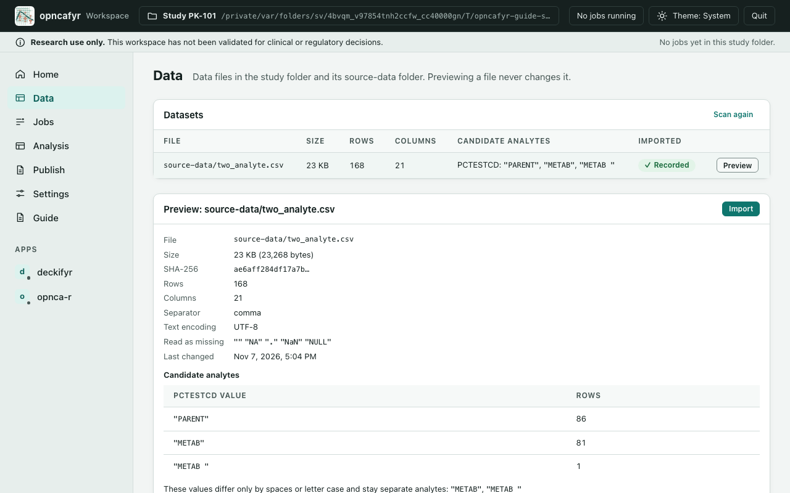
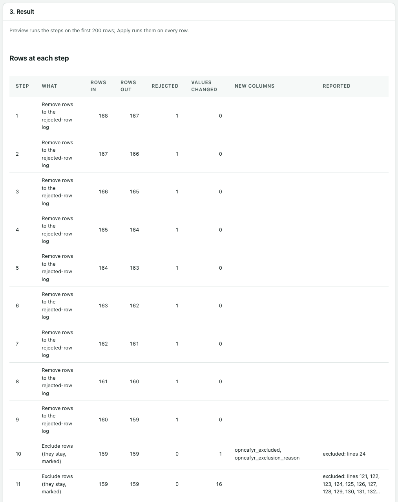

# Data and cleaning

You bring data in on the **Data** page and clean it on the **Analysis** page. The source file is never changed. Cleaning works on a copy inside the study folder, and every row it takes out is listed with a reason.

## The Data page

The **Data** page lists the data files that sit directly in the study folder or in its `source-data` folder. Files in deeper folders are not listed. The app reads CSV files.

For each file, the **Datasets** table shows its size, rows, columns, and the **Candidate analytes**: the values of any column that looks like an analyte code. Values are shown in quotes, so a stray space is visible: `"METAB "` is not `"METAB"`.

If you add or change a file while the app is open, select **Scan again**.

## Preview a file

Select **Preview** next to a file. Previewing reads the file and never changes it.

The preview shows:

- **Facts**: the file, its size, its fingerprint (SHA-256), rows, columns, the separator, the text encoding, which values are read as missing (blank, `NA`, `.`, `NaN` and `NULL`) and when the file last changed.
- **Check before cleaning:** problems with the file itself, such as rows with the wrong number of fields or repeated column names.
- **Candidate analytes**: each value of the analyte code column, with its row count. Values that differ only by spaces or letter case are pointed out. They stay separate analytes unless you clean them.
- **Columns**: each column's type, how many values are missing, and notes with examples of values that do not fit the type.
- **First 20 rows**, exactly as written.

## Import a file

When the preview looks right, select **Import**. The app records the file's size and fingerprint in the study folder. The **Imported** column then shows **Recorded**.

Importing does not copy or change the file. Each run later checks that the file still matches what was recorded. If you change the file and import it again, the app records it as a new source, and the old runs keep pointing to the old version.

## Clean the data

Cleaning happens on the **Analysis** page, in its first three cards.

### 1. Source and recipe

1. Under **Imported file**, choose the file you imported.
2. Select **New recipe**. A recipe is the list of cleaning steps for that file, kept in order.
3. To go back to a recipe you made before, choose it under **Recipe**. Each one shows how many steps it has.

### 2. Cleaning steps

Steps run from top to bottom. A recipe with no steps uses the data as it is. Nothing is removed unless a step says so, with a reason.

1. Choose a step in **Add a step…**. A small form opens.
2. Fill in the form. **Note (optional)** lets you say why the step is needed; the note is kept with the recipe.
3. Select **Add step**, or **Cancel** to close the form.
4. Use **Up**, **Down** and **Remove** to change the order or take a step out.

Every value you type is matched exactly, including spaces and letter case.

| Step | What it does |
|---|---|
| **Clean column names** | Makes column names lower case, with `_` in place of spaces and other marks, for example `Conc (ng/mL)` becomes `conc_ng_ml`. |
| **Rename a column** | Gives a column a new name. It cannot reuse a name the data has had. |
| **Trim spaces** | Removes spaces at the start and end of values in the columns you pick. |
| **Check numbers** | Reads a column as a number or a whole number, with a point or comma as the decimal mark. |
| **Replace values** | Replaces exact values in one column, for example a misspelt route. |
| **Copy a column** | Copies a column into a new column. |
| **Join columns** | Joins columns into a new column, with a separator you choose. |
| **Add a constant column** | Adds a new column with the same value on every row. |
| **Derive elapsed time** | Works out time since dose from a sample date-time and a dose date-time, in the unit you choose. You also describe the time zones in words. |
| **Convert units** | Converts values whose unit is exactly the text you give into another unit. |
| **Make a TRUE/FALSE column** | Makes a new TRUE/FALSE column from the values of another column. You say what each value means. |
| **Exclude rows (they stay, marked)** | Marks rows as excluded, with a reason. They stay in the data and opnca-r sees them as excluded. |
| **Remove rows to the rejected-row log** | Takes rows out of the cleaned data, with a reason. They are listed in the rejected-row log. |
| **Report duplicate rows** | Lists rows that have the same values in the columns you pick. It removes nothing. |

### Choosing rows

**Exclude rows** and **Remove rows** need you to say which rows. Under **Rows**:

1. Choose a column. The first choice, `opncafyr_line`, is the row's line number in the source file. The header is line 1, so the first data row is line 2. Checks and the rejected-row log use the same line numbers.
2. Choose a condition: **is**, **is one of (one per line)** or **is blank**.
3. Type the value, or one value per line.
4. Type a **Reason**. Every removed or excluded row needs one.

### Exclude or remove?

- **Exclude** when the sample is real but should not count, for example a haemolysed sample or a subject with no dose record. The row stays in the run's data with its reason.
- **Remove** when the row is not usable data, for example a duplicate copy or a value that cannot be read. The row goes to the rejected-row log with its reason.

### 3. Result

- **Preview** runs the steps on the first 200 rows. Use it to try a step quickly.
- **Apply to all rows** runs the steps on every row. You must apply the recipe before you can map its columns.

The result shows:

- a summary line, for example "All 168 rows: 159 kept, 9 rejected";
- **Rows at each step**: for every step, the rows in, rows out, rows rejected, values changed, new columns, and anything the step reported (such as duplicate lines);
- **Rejected rows**: each removed row's line, the step that removed it and the reason. This is the rejected-row log;
- **First rows after cleaning**.

For every step, rows in always equal rows out plus rows rejected. No row is dropped without a line in the rejected-row log.

When you change a step, the result is cleared and the app says "The recipe changed. Preview or apply it again."

## What cleaning never does

- It never changes the source file.
- It never drops a row without a reason.
- It never sets a below-the-limit (BLQ) or blank concentration to zero.
- It never puts nominal time in place of actual time.
- It never guesses units.
- It never resolves duplicates by itself. You choose which row to keep.

Derived values always go into a new column, so the original column is still there to compare.

Next: [Mapping columns and running checks](mapping-and-checks.md).
