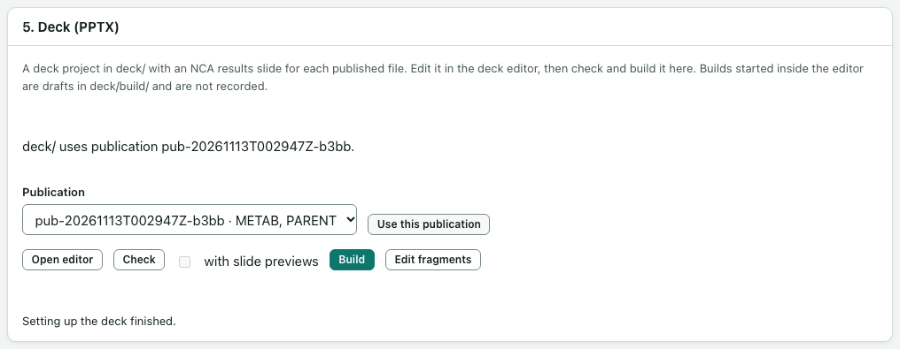

# PowerPoint decks

The **5. Deck (PPTX)** card on the **Publish** page builds a PowerPoint deck from one publication. The deck is a project in the study folder's `deck` folder, made with deckifyr.

A deck that builds without errors shows that the files were assembled as recorded. It does not show that the analysis is right.

## Set up the deck

1. Under **Publication**, choose a publication.
2. Select **Set up deck**. This runs as a job.

The new deck is an "NCA results" deck: a title slide, then one slide for each published table or figure. The footers come from the files' descriptions.

To use a different publication later, close the deck editor first, then choose the publication and select **Use this publication**. If you have edited the deck, the app asks first: **Replace presentation.yaml** starts again, **Keep my presentation.yaml** keeps your version.

## Edit the slides

1. Select **Open editor**. The deck editor opens inside the app.
2. Change the slides there, and select **Save** in the editor.
3. Go back to the **Publish** page and select **Close editor**. Closing saves any edits that were not saved.

Quitting the app, or the app closing itself after idle time, also saves the editor's edits first.

The editor has its own **Build** button. Builds made there are drafts for you to look at. The app does not record them; only **Build** on the **Publish** page makes a recorded build.

## Fragments

A fragment is a short piece of text, a table or a figure written in Quarto, that a slide can show.

1. Select **Edit fragments**. The fragments open in the app's project-file editor.
2. To make a new one, type a name under **New quarto fragment name** and select **Create**. Names use letters, digits, `-` and `_`.
3. Write the fragment and select **Save**.
4. In the deck editor, add a Quarto element to a slide and choose your fragment.

A fragment must not contain a slide break (`---`) or more than one top-level heading. The editor warns you when you save one that does.

## Check the deck

Select **Check**. The check runs on a copy that holds exactly the publication's files. It checks the description files first, then the deck itself. When nothing is wrong, the card says "The last check found nothing to fix." Otherwise it lists each problem with **Blocks** or **Warning**.

**Check** and **Build** wait while the deck editor or the fragment editor has unsaved changes. Save them, or close the deck editor.

## Tables with empty cells

A table with an empty cell builds: the cell stays empty on the slide. opnca-r's tables have empty cells whenever a parameter can't be calculated, for example a profile without λz. A formatted table (`.rds`) goes on its slide as a picture.

## Build and download

1. Tick **with slide previews** if you want a picture of each slide. This needs LibreOffice, which is optional and not installed by default. Without it, the box cannot be ticked.
2. Select **Build**. This runs as a job.
3. When it finishes, the build appears in the table, with when it was made, the publication and the runs it used.
4. Select **Download PPTX** to save the PowerPoint file.

Every build is kept in `deck/builds` with a record of the exact runs and file fingerprints it used. Download works only while the file still matches that record.

Decks are your own projects. Quarto fragments can run R code when the deck is built. They always run with the app's own R and Quarto.
