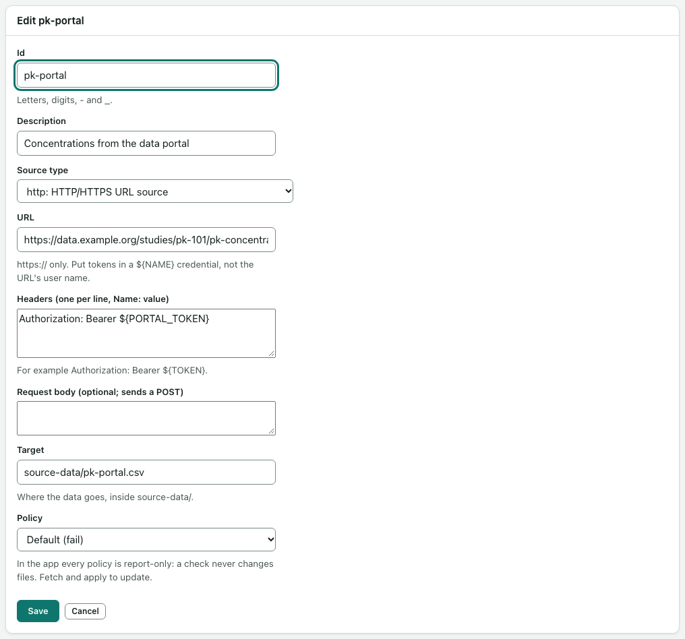

# External data (optional)

> **Research use only.** Fetching tells you which bytes you have and where they came from. It says nothing about whether the data is fit for analysis.

Some studies depend on data that lives somewhere else: a file on a data portal, a file on a network share, or one file in a Git repository. The **External data** page lists that data in the study, copies it into `source-data/` when you ask, and later checks whether the original has changed. It uses a tool called datum. You don't need it: the study folder works fully without it.

Nothing happens until you ask. Opening the page only reads the study's settings. The app never fetches or checks on its own, on opening a study, or in the background.

## Open the page

1. Open a study folder. **External data** appears in the left side once a folder is open.
2. If the page says it is unavailable, datum is not installed. Everything else in the app keeps working. See [A tool shows Unavailable](troubleshooting.md#a-tool-shows-unavailable).

## Set it up

The first time, the page says the study has no `.data.yaml` yet. Select **Set up** to create an empty one at the top of the study folder. Setting up never replaces a file that is already there.

`.data.yaml` lists the datasets. Next to it, `.data.lock.yaml` records what was last fetched. Both are ordinary files you can keep with [version history](version-history.md).

## Add a dataset

Select **Add a dataset** and fill in:

- **Id**: a short name, with letters, digits, `-` and `_` only.
- **Source type**:
  - **http**: a web address. It must start with `https://`.
  - **file**: a file or folder on this computer or a network share.
  - **git**: one file from a Git repository, at a branch or tag, over `https://`.
- **Target**: where the data goes. It must be inside `source-data/`, for example `source-data/pk.csv`.
- **Policy**: how datum labels a change it finds. In the app every policy only reports: a check never changes your files.

The form checks what you type as you go and names the field to fix. It refuses:

- sources that run commands;
- targets outside `source-data/`;
- plain `http://` addresses;
- SSH Git addresses;
- addresses that contain a user name or password.

If `.data.yaml` has comments, the form tells you before it saves: the app rewrites the file, so its comments are lost. Edit it in a text editor instead if you want to keep them.

### Files outside the study

A **file** source outside the study folder needs your approval first. The page shows **Approval needed** and, when you select **Review…**, the full path. Approve it only if you expect that path: a settings file you got from someone else must not copy something private into the study.

The approval is kept by the app on this computer, not in the study. A copy of the study on another computer, a renamed dataset or a changed path needs approval again.

### Access tokens

Some sources need a token. Put it in the settings as `${NAME}`, for example a header `Authorization: Bearer ${TOKEN}`, never in the address itself. The page then shows a **Credentials for this session** box with one hidden field for each name.

What you enter stays in the page. It is sent with one check or fetch and is never saved, logged or written to the study. Messages from datum are cleaned of it before you see them.

## Fetch

Select **Fetch…** on a dataset, or **Fetch all…**. The data is downloaded or copied into a review area first. Nothing in `source-data/` changes yet.

The **Review** then lists every file:

- **New file**: not in the study yet;
- **Unchanged**: the study already has these bytes;
- **Will replace**: a file in the study gets new bytes;
- **Will remove**: a folder source no longer has this file.

The review gives each file's size and fingerprint (SHA-256). It shows no data values.

- **Apply** puts the files in place. Each replaced or removed file is kept first, under `.opncafyr/datafetch/previous/`.
- **Discard** throws the fetch away. Nothing in the study changed.

Apply refuses, and says why, when a file, `.data.yaml` or `.data.lock.yaml` changed after the fetch. Discard the review and fetch again.

Existing runs are never affected: each run keeps its own copy of its input. To analyse new data, import it and start a new run.

If the app stops in the middle of Apply, the page says **An earlier Apply was interrupted**. Select **Finish applying** to complete it, or **Roll back** to put the files back as they were.

## Check for updates

Select **Check for updates** to ask every source whether it changed since the last fetch. A check never changes your files, `.data.yaml` or `.data.lock.yaml`, whatever the policy. The page shows **Changed upstream** for each dataset whose source changed. Fetch and apply to update it.

https and git sources need the network. Without it, a check or fetch stops quickly with "The source could not be reached" and changes nothing. File sources work offline.

## Fetched files in the Data page

A fetched file is an ordinary file in `source-data/`: preview and import it as usual (see [Data and cleaning](data-and-cleaning.md)). Its preview says which dataset it came from and whether it still has the bytes that were applied. Import records the file's fingerprint, so each run records which bytes it used.

## Delete, undelete and forget

- **Delete files…** removes a dataset's files from `source-data/`, after listing them. A copy of each is kept under `previous/`, and checks skip the dataset until you **Undelete** it and fetch again.
- **Remove…** takes a dataset out of `.data.yaml`. Its files stay where they are. The page then offers **Forget lock entry**, which drops its record from `.data.lock.yaml`.
- **Purge…** permanently deletes a dataset's earlier copies in `previous/`. The page shows how much space they use.
