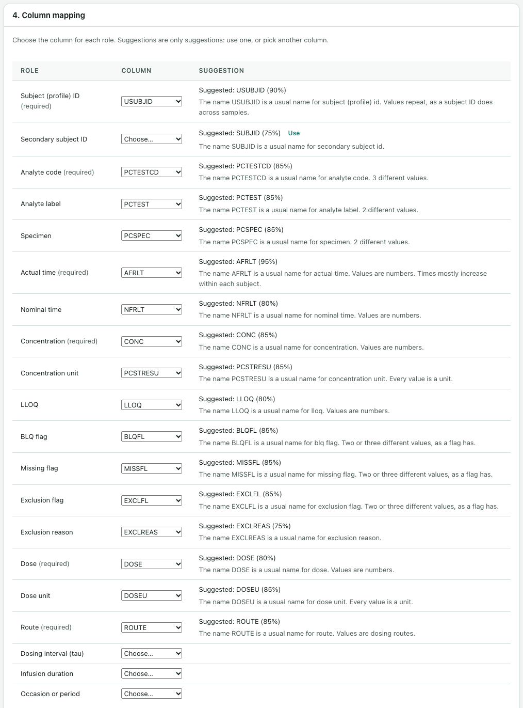
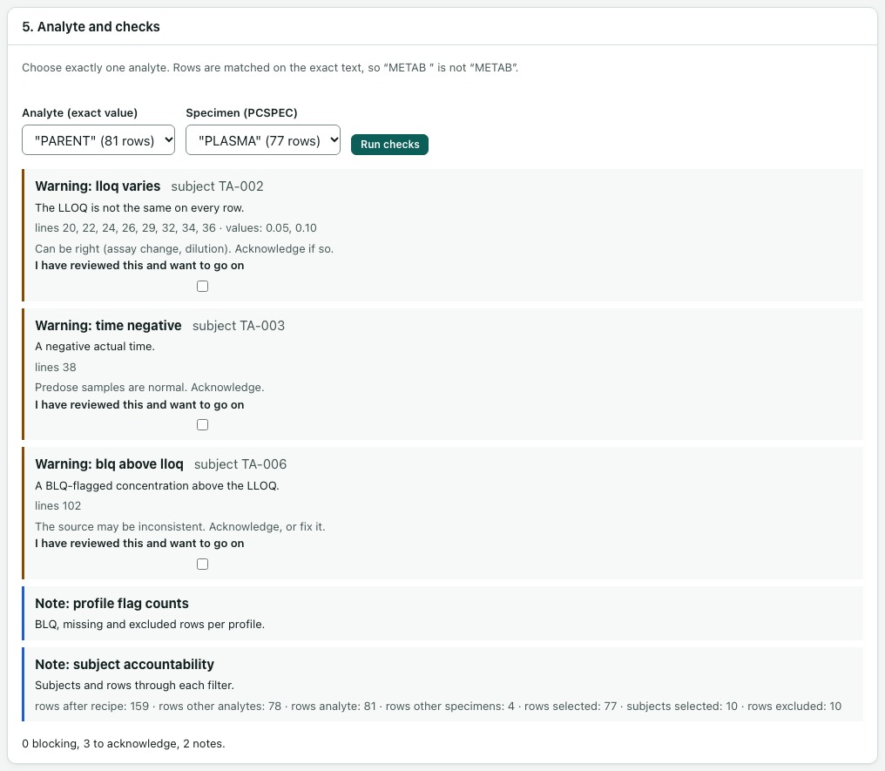

# Mapping columns and running checks

After cleaning, you tell the app what each column means, choose one analyte, and run the checks. The app makes suggestions, but it never fills anything in for you. When a choice is unclear, it asks.

These steps are cards 4, 5 and 6 on the **Analysis** page. Card 4 appears once you have selected **Apply to all rows** in card 2.

## 4. Column mapping

The table lists every role the analysis can use. For each role, choose the column that holds it, or **(not in this data)**.

Six roles are marked **(required)**: **Subject (profile) ID**, **Analyte code**, **Actual time**, **Concentration**, **Dose** and **Route**. The others are optional. Map the ones your data has, such as **Specimen**, **Nominal time**, **LLOQ** and the flag columns.

The **Suggestion** column helps you:

- **Suggested: COLUMN (75%)** means the app thinks that column fits, with how sure it is and why. Select **Use** to take it, or pick another column. A suggestion is never used until you pick it.
- **Your choice:** means the app could not tell, for example because two columns fit equally well. It lists the candidates. You decide.

A few rules:

- **Analyte code** is the column with short codes such as `PARENT`. A label column, such as one holding "Parent drug", goes under **Analyte label**. Labels are only for display.
- **Actual time** must be elapsed time since the dose, as a number. Mapping a nominal time column here, or a column of clock times such as `08:30`, blocks the run. There is no way around this. If you only have date-times, add a **Derive elapsed time** step first.
- A column can be used for one role only.

### Units

Under **Units**, say how each unit is given, for time, concentration and dose:

- **A unit column**: choose the column that holds the unit on each row, for example `PCSTRESU`. Its values are shown next to it.
- **One unit for every row**: type the unit, for example `h`, `ng/mL` or `mg`.

The app never guesses a unit. If a column name contains a unit, the app says "The header says ng/mL: confirm it above." You still have to choose. The app tidies spelling only (for example `ng/ml` becomes `ng/mL`). Different units within one analyte, even equivalent ones such as `ng/mL` and `ug/L`, block the run until you add a **Convert units** step.

### Flag columns: BLQ, missing and excluded

When you map **BLQ flag**, **Missing flag** or **Exclusion flag**, the app lists every value the column holds, with its row count. For each value, choose **TRUE** or **FALSE**. A blank value shows as `""`.

- Any value you leave unset blocks the run, because its meaning is unclear.
- Under **BLQ flag**, tick **Also BLQ: concentration text starting with “<”** if your data writes some results as text such as `<LLOQ`. Those rows are then treated as BLQ, and the text is kept as it was.
- Under **Exclusion flag**, if you have not mapped an **Exclusion reason** column, the app asks for one reason for every excluded row.

A sample that was not analysed is missing, not BLQ. A row flagged as both blocks the run.

### Routes

If you map **Route**, the app shows each route value and how opnca-r reads it. A value opnca-r does not know shows as "Not recognised: add a “Replace values” step". The app never fills in a blank route.

### Save the mapping

Select **Save mapping**. Anything that still blocks is listed under **Still to do**. The message says "Mapping saved." when nothing is left, or "Saved. Some roles still need a choice." when something is.

## 5. Analyte and checks

Each run analyses exactly one analyte. Rows are matched on the exact text of the analyte code, so `"METAB "` (with a space) is not `"METAB"`.

1. Under **Analyte (exact value)**, choose the analyte. Each value shows its row count.
2. If you mapped **Specimen**, choose one specimen, for example `"PLASMA"`. Rows of other analytes and specimens are counted, not rejected.
3. Select **Run checks**.

The status line sums up what was found, for example "0 blocking, 3 to acknowledge, 5 notes." Each finding shows its level and name (for example **Blocking: conc negative**), the subject, a message, the source line numbers, and a hint on how to fix it.

A little later, opnca-r's own data check finishes and adds its findings as notes.

### Blocking findings

A blocking finding stops the run until you change the recipe or the mapping. The common ones:

| Finding | What it means | Usual fix |
|---|---|---|
| role unmapped | A required role has no column. | Map it. |
| analyte no rows | No row has exactly this analyte value. | Pick a value from the list. |
| specimen mixed | More than one specimen is left. | Map the specimen column and choose one. |
| time not numeric | Actual time is not a number. | Fix it with a step, or remove the row with a reason. |
| conc not numeric | Concentration is not a number, not blank and not BLQ. | Use **Check numbers** for decimal commas, or remove the row. |
| conc unclassified blank | A blank concentration is neither BLQ nor missing. | Flag it in the source data, or remove it with a reason. |
| conc negative | A negative concentration. | Remove or exclude the row with a reason. |
| route missing | The route is blank. | Remove the row, or replace the value, with a reason. |
| route unrecognised | opnca-r does not know this route. | Add a **Replace values** step. |
| route varies, dose varies | A profile has more than one route or dose. | One route and one dose per profile. |
| units mixed, units undeclared | Units differ, or a unit is missing or unknown. | Add **Convert units**, or declare the unit. |
| duplicate key | Two or more rows share a subject and actual time. | Exclude or remove all but one, with a reason. |
| blq and missing | A row is flagged both BLQ and missing. | A row is one or the other. |
| flag value unmapped | A flag value has no TRUE or FALSE. | Say what it means in the mapping. |
| exclusion no reason | An excluded row has no reason. | Add an **Exclude rows** step with the reason. |
| time nominal as actual | The actual time column is nominal time. | Map an actual elapsed time column. |
| time clock format | Actual time holds clock times. | Map elapsed time, or use **Derive elapsed time**. |
| profile no dose | A profile has no dose or no route. | Add the dose, or exclude the profile with a reason. |

After you change the recipe, select **Apply to all rows** again, then **Run checks** again.

### Warnings

A warning may be right for your data, but you must look at it. Each warning has a box, **I have reviewed this and want to go on**. Tick it for every warning before you can start the run. Your acknowledgements are recorded with the run.

| Warning | What it means |
|---|---|
| conc zero not blq | A concentration of 0 after the dose, with no BLQ flag. It may be a hidden BLQ. |
| blq above lloq | A BLQ-flagged concentration above the LLOQ. The source may be inconsistent. |
| lloq varies | The LLOQ is not the same on every row. This can be right, for example after an assay change. |
| time negative | A negative actual time. Predose samples are normal. |
| id usubjid not one to one | A second subject ID column does not match the subject ID one to one. |

### Notes

Notes need no action. They include rows that are out of time order, profiles with fewer than 3 measurable samples after the dose, counts of BLQ, missing and excluded rows per profile, and how many subjects and rows pass each filter.

## 6. Start analysis

Card 6 sets the run's choices.

1. **Label for this analyte (shown in reports)** is filled in from the analyte label column if you mapped one. Change it if you want.
2. Choose how BLQ samples are handled. There is no default: opnca-r uses exactly what you pick.
   - **BLQ before the dose**
   - **BLQ after the dose**
   - **BLQ at the end of the profile**
   - Each offers **Exclude the sample**, **Set to zero**, **Half the LLOQ** or **LLOQ / √2**.
3. Choose the **BLQ method**: **Conventional (rules above)** or **Censored log-normal**.
4. Select **Start analysis**.

While **Start analysis** is greyed out, the line above it says why: the checks have not run, something still blocks, a warning is not acknowledged, or a BLQ choice is missing.

**Start analysis** freezes this analyte's rows and your choices into a new run. It does not open opnca-r yet. The next step is in [Analyte runs in opnca-r](analyte-runs.md).
