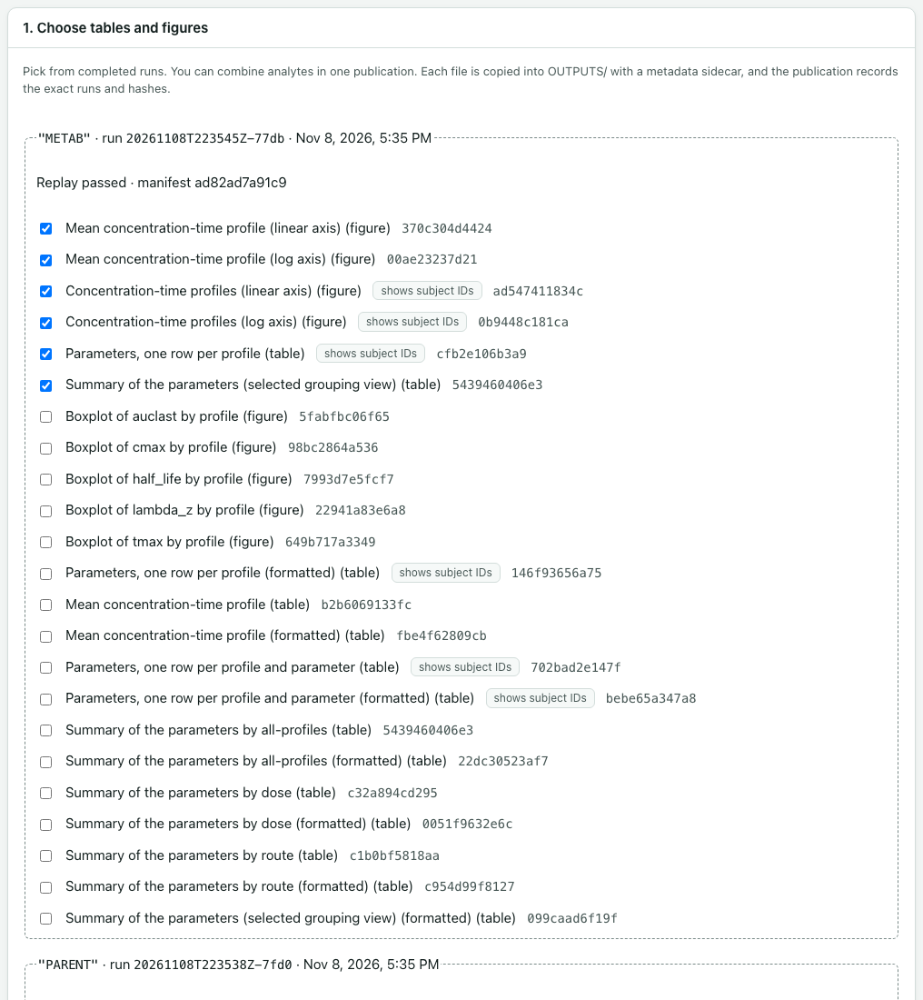

# Publishing tables and figures

Publishing copies chosen tables and figures from completed runs into the study folder's `OUTPUTS` folder. Reports and decks are then built from those copies. Publishing never changes a run.

All of this happens on the **Publish** page.

## Which runs can be published

Only **Completed** runs can be published: runs whose replay matched, that you confirmed, and whose files still match their recorded fingerprints. Any other run is listed under a table of runs that can't be published, with the reason.

One publication can combine runs of different analytes.

## 1. Choose tables and figures

Each completed run has a box with its analyte, its run ID, when it was made, and "Replay passed". Inside are the tables and figures opnca-r saved, under the names opnca-r gives them. opnca-r also says which files show subject IDs. For a run saved by opnca-r 0.3.1, the box typically holds:

| Offered | Ticked to begin with | Shows subject IDs |
|---|---|---|
| Summary of the parameters (table) | Yes | No |
| Parameters, one row per profile (table) | Yes | Yes |
| Concentration-time profiles, linear and log axis (figures) | Yes | Yes |
| Mean concentration-time profile, linear and log axis (figures) | Yes | No |
| Mean concentration-time profile (table) | No | No |
| Parameters, one row per profile and parameter (table) | No | Yes |
| Summary of the parameters by group (tables) | No | No |
| Boxplot of each parameter by profile (figures) | No | No |
| Any of these tables, **(formatted)** | No | As the table |

A **(formatted)** table is the same table as opnca-r laid it out, with units in the headers and footnotes. Reports and decks show it as it is. The plain table is the one the replay checked. Pick either, or both.

Items that show subject IDs are marked **shows subject IDs**. If a run was saved without the mean figures, the box says so; make a new run and keep them ticked in opnca-r's **Save to run folder** box to include them. A table that the replay doesn't recompute, such as a bioequivalence table, can't be published, and the box says why.

Runs saved by an earlier opnca-r keep their earlier names, such as "Parameter summary" and "Individual parameter listing".

1. Tick the items you want, from one run or several.
2. Type a **Label (optional)**, for example "PARENT and METAB".
3. Select **Check**. The app shows the name each file will have in `OUTPUTS`, which run it comes from, whether it shows subject IDs, and whether it is a **New copy** or **Already published (same bytes)**. Nothing is written yet.
4. If the check is clean, select **Publish**. If you change the selection after checking, check again first.

The message then names the new publication and counts its files and runs, for example "12 file(s) from 2 run(s)".

## What publishing does

- It copies each file into `OUTPUTS/tables` or `OUTPUTS/figures`. The name holds the analyte, the run ID and the item. The copy is byte for byte the same as the run's file.
- It writes a small description file next to each copy. Reports and decks use it for footnotes: where the result came from, the analyte and run, and abbreviations.
- It checks every copy and description file.
- It records the publication, with the exact runs and fingerprints of every file it used. Reports and decks always name this record, never "the latest" run.

A published file is never replaced. If a file name in `OUTPUTS` already holds something different, for example because someone edited the file, the whole publication is refused and nothing is written. Make a new run, or ask for help.

If publishing is interrupted, the files already copied are not part of any publication, and reports and decks never use them.

## 2. Publications

This card lists every publication: its ID, label, analytes, number of files and when it was made. A report or deck is built from one publication.

### Add or remove files: revise a publication

A publication never changes. To add or remove files, make a new one from it:

1. In the **Publications** table, select **Revise** on the publication to start from.
2. The **Choose tables and figures** card ticks that publication's files. Tick or untick files, including files from other completed runs. Files whose run can't be published any more are left out, and the card says how many.
3. Select **Check**, then **Publish**. The message says "It revises pub-…".

The new publication has its own ID and is a separate record that says which publication it started from. The earlier publication, its files, and every report or deck build made from it stay exactly as they were. A report or deck moves to the new publication only when you choose it there with **Use this publication**. **Stop revising** returns the card to its usual selection.

## 3. Published files

Select **Check published files** to check everything in `OUTPUTS`: that each file has its description file, and that they still match. The card lists any problem, with **Blocks** or **Warning**. Run this check if you suspect a file in `OUTPUTS` was changed.

Next: [Word reports](reports.md) and [PowerPoint decks](decks.md).
