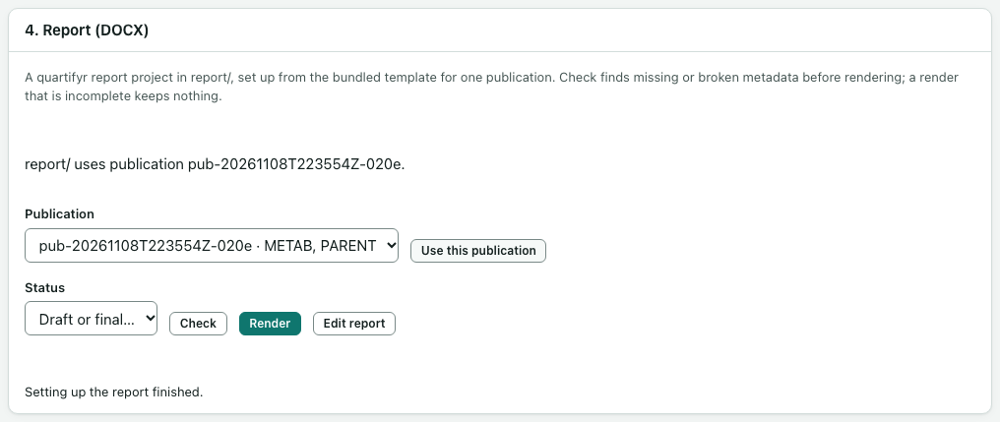

# Word reports

The **4. Report (DOCX)** card on the **Publish** page builds a Word report from one publication. The report is a project in the study folder's `report` folder, made from a template that comes with the app. The app uses quartifyr and reportifyr to build it.

A report that builds without errors shows that the files were assembled as recorded. It does not show that the analysis is right.

## Set up the report

1. Under **Publication**, choose a publication. Each shows its ID, its label and its analytes.
2. Select **Set up report**. This runs as a job. When it finishes, the card says which publication `report` uses.

The new report has one captioned table or figure for each published file, with footnotes taken from the files' descriptions.

To use a different publication later, choose it and select **Use this publication**. If you have edited the report text, the app asks first: **Replace report.qmd** starts again from the template, **Keep my report.qmd** keeps your text.

## Check the report

Select **Check**. The check looks for anything that would block or weaken the build, such as a missing or broken description file. It works on a copy that holds exactly the publication's files, each checked against its fingerprint. When nothing is wrong, the card says "The last check found nothing to fix." Otherwise it lists each problem with **Blocks** or **Warning**.

**Formatted tables (`.rds`).** The app checks every formatted table in the publication. A formatted table that carries its own caption is refused, with a message naming the file: a report that included one left its place in the report unfilled, so Render stops. Use the CSV version of that table in the report, or use the formatted one in a deck. Runs saved by opnca-r 0.3.2 or later don't have this caption; for an older run, make a new run and publish that. A plain **Check** also warns when an older report project still sizes figures by their pixels (`use_artifact_size: true` in `report/config.yaml`); set it to `false` and render again.

**Page layout.** New reports fit figures to the page width (6 inches). A table with many columns is fitted to the page: its columns get the width their longest word needs, and the text is made smaller (down to 7 pt) when it has to be. If a table still can't fit at that size (opnca-r's summary table, with 22 columns, usually can't on a portrait page), **Render** still finishes, fits the table as well as it can and records a note on the build that names the table; a word in it may break across lines. For a cleaner table choose fewer columns or shorter headers, or give it a landscape page. To do that, open **Edit report** and put `` before the table and `` after it. A figure on a landscape page keeps its portrait size. Widths are estimated from character counts, not measured, so look at the DOCX in Word. Whatever you change there isn't recorded in the build.

## Edit the report

Select **Edit report**. The report text opens in the app's project-file editor:

- **Source** shows and edits everything.
- **Visual** edits only plain headings, paragraphs and lists. The parts that place tables, figures and footnotes are locked, so you cannot break them by accident.
- **Preview** is an approximate view. The real report may look different.

Two more files are listed after the report. Both open as plain text, with a short description above them:

- **Report settings (config.yaml)** holds how tables, figures and footnotes are filled in: the figure width, the footnote style, and similar. Most reports need no change. Each line reads `setting: value`, where a value is `true` or `false`, a number, or text, as the file's own comments say. Keep `report_dir_name` and `outputs_dir_name` as they are.
- **Footnotes (standard_footnotes.yaml)** holds the abbreviations and footnote wording that a published file's description may name.

When you save one of them, the app notes anything that looks wrong, such as a setting that is misspelled, or text where `true` or `false` belongs. The save still happens. **Check** lists the same notes, and **Render** stops if the settings file isn't valid YAML or changes the two folder names. A figure-size warning from **Check** (`use_artifact_size`) is fixed here: open **Report settings**, change `use_artifact_size: true` to `false`, and save.

Select **Save** to keep your changes, or **Discard changes**. If the file changed on disk while you were editing, nothing is overwritten: the app shows both versions and you choose which one to keep.

While the editor has unsaved changes, **Check** and **Render** wait. The card says "The report editor has unsaved changes. Save or discard them first."

## Draft or final

Choose **Draft** or **Final** under **Status**. This is a setting of the report, and every build records it. **Render** asks you to choose before it starts.

## Render and download

1. Select **Render**. This runs as a job and may take a few minutes. It works offline.
2. When it finishes, the build appears in the table below, with when it was made, the publication, the runs and the settings it used.
3. Select **Download DOCX** to save the Word file.

Every build is kept in `report/builds` with a record of the exact runs and file fingerprints it used. Download works only while the file still matches that record.

A build is marked **Out of date** once the report text, its settings or the published files change after it was made. The build itself is never changed; render again to get a current one.

A render that fails, runs out of time or is cancelled keeps nothing, so a half-made report never looks finished. If a render fails, see [A report render fails](troubleshooting.md#a-report-render-fails).

When you open the report, Word may ask whether to update fields. That is expected.
