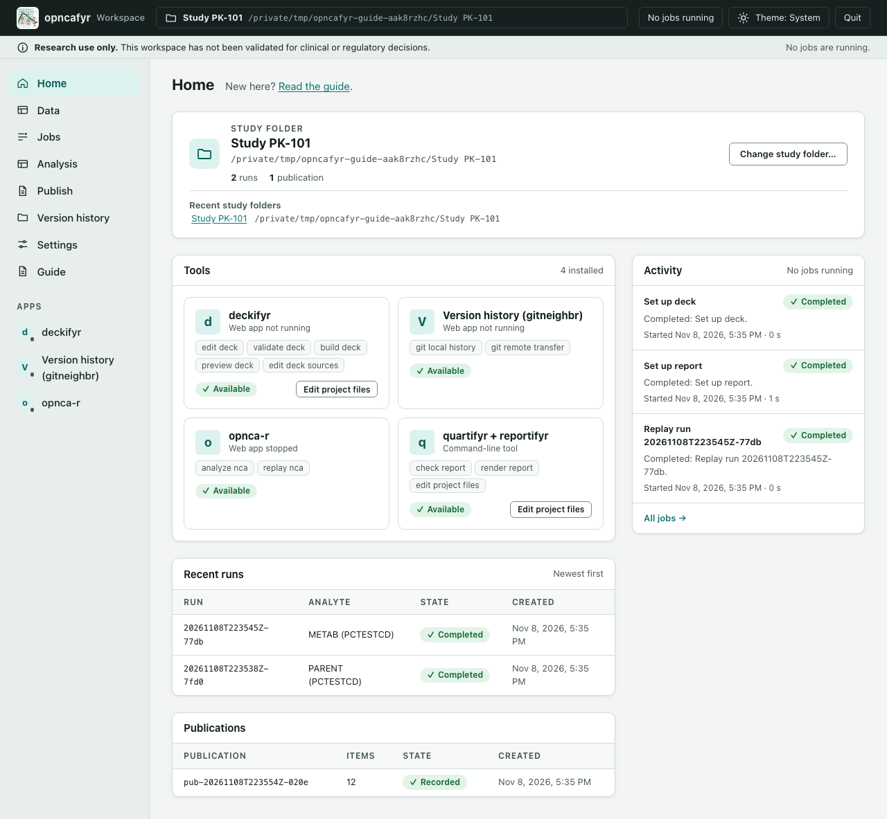

# Your study folder

A study folder keeps one study's data, cleaning, runs, reports and decks together. You choose where it lives, for example in your Documents folder or on a shared drive you can write to.

## What the app adds to a folder

When you turn a folder into a study folder, the app adds one folder called `.opncafyr`. Your computer may hide it, because its name starts with a dot. It holds the app's records: imported files, cleaning recipes, runs, publications and jobs.

Later steps add more folders, but only when you use them:

| Folder | Made when | What it holds |
|---|---|---|
| `source-data` | you make it | the data files you want to work with |
| `OUTPUTS` | you publish | copies of the tables and figures you chose |
| `report` | you set up a report | the Word report project and its builds |
| `deck` | you set up a deck | the PowerPoint deck project and its builds |
| `.git`, `.gitignore` | you set up [version history](version-history.md) (optional) | Git's snapshots of files you chose, and the files left out of them |

The app never changes, moves or rewrites your source files. Cleaning reads them and writes its results inside `.opncafyr`.

Do not put a study folder inside a hidden folder (a folder whose name starts with a dot). Reports cannot be built there.

## Create or open a study folder

1. In Finder or File Explorer, make a new folder for the study, for example `Documents/TA-study`. Inside it, make a folder called `source-data` and copy your data files into it.
2. In the app, go to **Home** and select **Choose study folder…**. Your computer's folder picker opens.
3. Pick the folder and confirm. The app shows what it found: the folder, whether you can write there, and how many items it holds.
4. Select the button the app offers:
   - **Create workspace here** for a folder that is not a study folder yet. This adds only the `.opncafyr` folder.
   - **Open workspace** for a folder that is already a study folder.
   - **Upgrade (backup kept) and open** for a study folder made by an older version. The app keeps a copy of the old records before it upgrades them.
5. The study folder's name now shows on the **Home** page and in the top bar.

To switch studies, select **Change study folder…**, or pick one under **Recent study folders**. A recent folder that has moved or been deleted shows as "(not found)".

If the app was stopped while a job was running, opening the folder again marks that job as failed. The message on **Home** tells you how many.

## The Home page

**Home** has four cards under the study folder.

- **Tools** lists the installed tools: opnca-r, quartifyr + reportifyr, and deckifyr. Each shows what it can do and its health: **Available**, **Checking** or **Unavailable**. A tool with its own screen also shows whether that screen is running, and a button such as **Open opnca-r** while it is. If a tool shows **Unavailable**, see [A tool shows Unavailable](troubleshooting.md#a-tool-shows-unavailable).
- **Recent runs** lists this study's runs, newest first, with the analyte and the state, such as **Preparing**, **Reviewing** or **Completed**. A run whose records are damaged shows as **Incomplete** and never as finished.
- **Publications** lists the sets of tables and figures you have published, with how many files each holds.
- **Activity** shows running jobs and the last few finished ones. **All jobs →** opens the **Jobs** page.

## Jobs

Cleaning, checks, replays, report renders and deck builds run as jobs, so the page stays usable while they work. The top bar shows how many jobs are running, and the **Jobs** link in the left side shows a count while any are.

The **Jobs** page lists every job in the study folder, newest first. Each job shows:

- its name and state: **Queued**, **Preparing**, **Running**, **Reviewing**, **Completed**, **Failed** or **Cancelled**;
- a short message, which says why a job failed;
- when it started and how long it took.

A job that has not finished has a **Cancel** button. A cancelled or failed job keeps nothing half-made: its results never look complete.

## Quitting with jobs running

If you select **Quit** while jobs are running, the app asks what to do:

- **Keep running and quit when finished** lets the jobs finish, then stops the app. A **Keep the app open** button appears in case you change your mind.
- **Cancel jobs and quit** stops the jobs now.
- **Don't quit** goes back.
