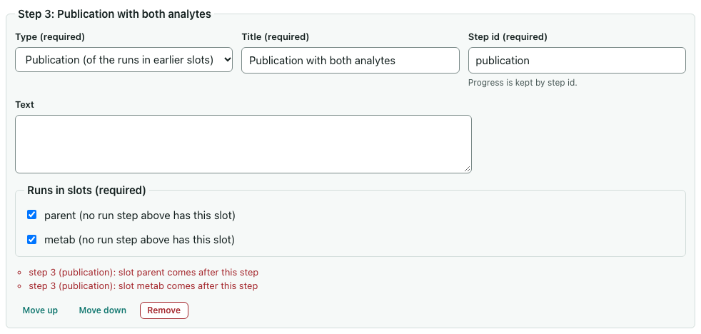
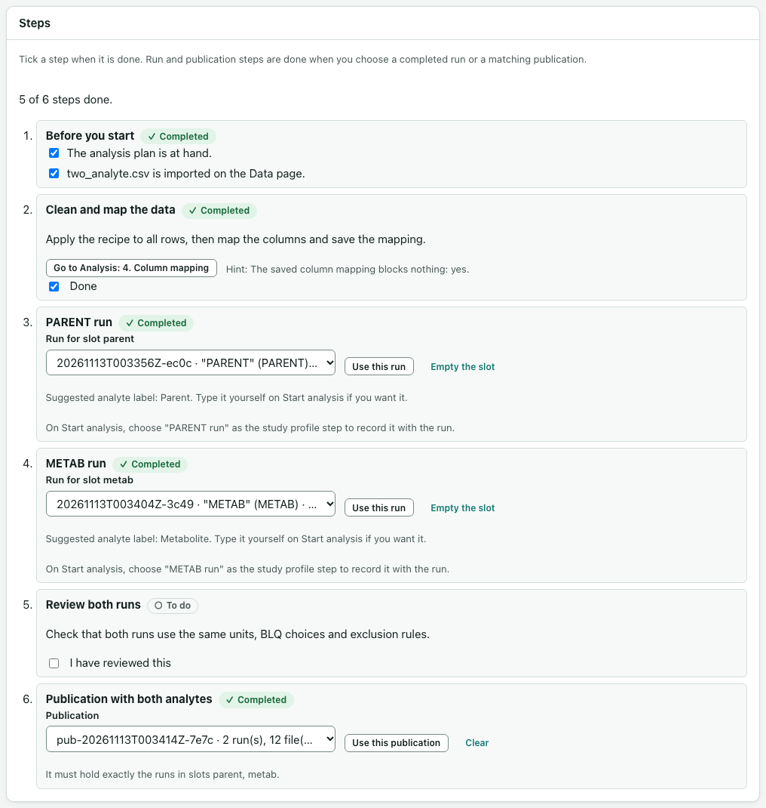

# Study profiles (optional)

A study profile lists the steps your team agreed for a kind of study, such as dose escalation, fed/fasted or a drug-drug interaction study. It sets out what to check, which runs to make, and which runs to publish together. The **Study profile** page shows the steps, takes you to the right card, and keeps your progress.

A profile is guidance only:

- It never chooses an analyte, a dose, a unit, a BLQ rule, an exclusion or a comparison.
- It never starts, changes or publishes a run.
- opnca-r does the NCA. Finishing every step of a profile does not show that the analysis is right.

Each run still has exactly one analyte, and a change to cleaning, mapping or BLQ choices still makes a new run.

## Start from an example

The app comes with three examples: **Dose escalation study**, **Fed/fasted study** and **Drug-drug interaction study**. They are illustrations, not templates for every protocol.

1. Open a study folder, then select **Study profile** on the left.
2. Under **Examples**, select **New from example** for the one closest to your study. The editor opens with a copy of it (see [Edit a profile in the app](#edit-a-profile-in-the-app)).
3. Give the file a name, change the profile to match your protocol and analysis plan (the words, the number of cohorts or periods, the checklist items), and select **Save as new study profile**. It is saved as `profiles/<name>.yaml` in the study folder. Saving never replaces a file that is already there.
4. Choose the profile under **Profile in profiles/** and select **Follow this profile**.

**Copy into this study** copies an example unchanged, comments included, if you would rather edit the file in a text editor. After editing a file outside the app, select **Check again**. If the file has a mistake, the page lists each problem with the step and field it is in.

## Edit a profile in the app

Choose a profile under **Profile in profiles/** and select **Edit**, or select **Edit to fix** beside a profile that can't be used. The editor replaces the page until you close it.

- **About this study profile**: the id, your version label, the title and an optional description.
- **Steps**: each step has a type, a title and a step id. A new step's id follows its title until you change it. The other fields depend on the type: text, checklist items, the control an action points at, a run slot, or the slots a publication holds.
- **Move up**, **Move down** and **Remove** change the order. They are ordinary buttons, so the keyboard works as well as the mouse.
- **Controls and hints** are chosen from lists, by name. You can't type an id, so the profile can't name a control the app doesn't have.
- **Runs in slots** for a publication lists only the slots of run steps above it.



The editor checks the profile as you type. **Check** lists each problem with the step it is in; **Go to step** takes you there. **Save** writes the file only when nothing is wrong. **Preview the steps** shows them as a list.

Good to know:

- Saving rewrites the file from the form. Comments (lines starting with `#`) are not kept, and the editor says so before you save a file that has them.
- Saving writes only that file. It never changes a run, a publication or your progress. If you edit the profile you follow, the page then asks you to adopt it (see below).
- If the file changed on disk after you opened it, nothing is saved. You can save your version as a new file, or open the file on disk instead.
- Unsaved edits count as unsaved changes: **Quit** asks you to save or discard them.
- The editor opens a file only when it is well formed. A file with a YAML mistake or an unknown field shows its problems instead: fix those in a text editor first.

## Follow the steps

Each step shows **To do** or **Completed**. The page counts how many steps are done.



- **Instruction**: read it, then tick **Done**.
- **Checklist**: tick each item. The step is done when every item is ticked.
- **Action**: select **Go to …** to open the right card on the Analysis or Publish page. Some actions also show a hint, such as "The recipe is applied to all rows: not yet". A hint only reports what the page shows. It never ticks the step for you: tick **Done** yourself.
- **Review checkpoint**: tick **I have reviewed this** once you have.
- **Run**: when the run is completed, choose it under **Run for slot …** and select **Use this run**. Only completed runs can fill a slot, and a run can fill only one slot. Nothing is chosen for you.
- **Publication**: publish tables and figures from exactly the runs in the step's slots on the Publish page. Then choose that publication here and select **Use this publication**. The app checks that its runs are exactly those runs.

Your progress is saved in the study folder, in `.opncafyr/study-profile.json`, so it is still there after a reload or the next time you open the app. **Stop following** keeps the progress for later.

## Record the step with a run or publication

While you follow a profile, **Start analysis** and **Choose tables and figures** show **Study profile step (optional)**, set to **None**. If you choose a step there, the run or publication records the profile's name, version, file fingerprint (SHA-256) and step. That record is provenance only: it does not change the analysis, and a completed run is never changed afterwards. The **Run for slot** list marks runs made for that step, but you still choose the run yourself.

## When the profile file changes

If someone edits the profile file, in the app or outside it, the page says so. It lists the steps the edit added and removed, and nothing can be ticked until you select **Adopt edited profile**. Adopting keeps the progress of steps that still exist and drops the rest. The earlier version's fingerprint is kept in the progress file. Runs and publications made earlier keep the version they recorded.

## Write a profile

A profile is a YAML file in the study's `profiles/` folder. Its name uses lower-case letters, digits and dashes, and ends in `.yaml`, for example `profiles/fed-fasted.yaml`. A file can be at most 256 kB.

```yaml
schema_version: "1.0"
id: fed-fasted          # lower-case letters, digits and dashes
version: "1"            # your own version label
title: Fed/fasted study
description: Optional text shown with the profile.
steps:
  - id: before-you-start
    type: checklist
    title: Before you start
    items:
      - id: plan
        text: The protocol and analysis plan are at hand.
  - id: map
    type: action
    title: Map the columns
    target: nca.mapping.card
    hint_condition: nca.mapping.ready
    text: Choose the column for each role and the units, then save the mapping.
  - id: run-fasted
    type: run
    title: Fasted run
    slot: fasted
    suggested_label: Fasted
  - id: run-fed
    type: run
    title: Fed run
    slot: fed
  - id: review
    type: checkpoint
    title: Review both runs
    text: Check that both runs use the same analyte value, units and BLQ choices.
  - id: publication
    type: publication
    title: Publication with both periods
    slots: [fasted, fed]
```

Every step has an `id` that is unique in the profile, a `type` and a `title`. Step `text` is optional unless noted.

| Type | Also takes |
|---|---|
| `instruction` | `text` (required) |
| `checklist` | `items`: a list of `id` and `text` |
| `action` | `target` and `text` (both required), and optionally `hint_condition` |
| `run` | `slot` (required, unique in the profile) and optionally `suggested_label` |
| `checkpoint` | `text` (required) |
| `publication` | `slots`: run slots listed earlier in the profile |

A profile can't contain anything else. It has no place for code, web addresses, file paths, commands or scientific choices, and the app refuses a file that tries to add one.

### Targets and hints

`target` names a card or button. `hint_condition` names something the page can report.

| Target | Where |
|---|---|
| `nca.recipe.card` | Analysis: 1. Source and recipe |
| `nca.steps.card`, `nca.steps.apply` | Analysis: 2. Cleaning steps, Apply to all rows |
| `nca.result.card` | Analysis: 3. Result |
| `nca.mapping.card`, `nca.mapping.save` | Analysis: 4. Column mapping, Save mapping |
| `nca.analyte.card`, `nca.analyte.check` | Analysis: 5. Analyte and checks, Run checks |
| `nca.start.card` | Analysis: 6. Start analysis |
| `nca.runs.card` | Analysis: 7. Runs |
| `nca.curator.card` | Publish: 1. Choose tables and figures |
| `nca.publications.card` | Publish: 2. Publications |
| `nca.report.card`, `nca.deck.card` | Publish: 4. Report, 5. Deck |
| `shell.workspace.pick`, `shell.data.datasets` | Home: Choose study folder, Data: the list of data files |

| Hint condition | Means |
|---|---|
| `shell.workspace.open` | A study folder is open |
| `shell.dataset.imported` | The study has an imported data file |
| `nca.recipe.chosen` | A recipe is chosen on the Analysis page |
| `nca.cleaned.ready` | The recipe is applied to all rows |
| `nca.mapping.ready` | The saved column mapping blocks nothing |
| `nca.checks.ready` | The checks ran for one analyte with nothing blocking |
| `nca.run.created`, `nca.run.completed` | The study has a run, a completed run |
| `nca.publication.recorded` | The study has a recorded publication |

## Several runs, one report

Make one run per analyte, period, treatment or cohort, each with its own recipe if the rows differ. For example, a recipe can use a **Remove rows to the rejected-row log** step that keeps one period, with a reason. Then publish tables and figures from exactly those runs together. A report or deck is built from one publication, so it holds those runs and no others. See [Publishing tables and figures](publishing.md).
