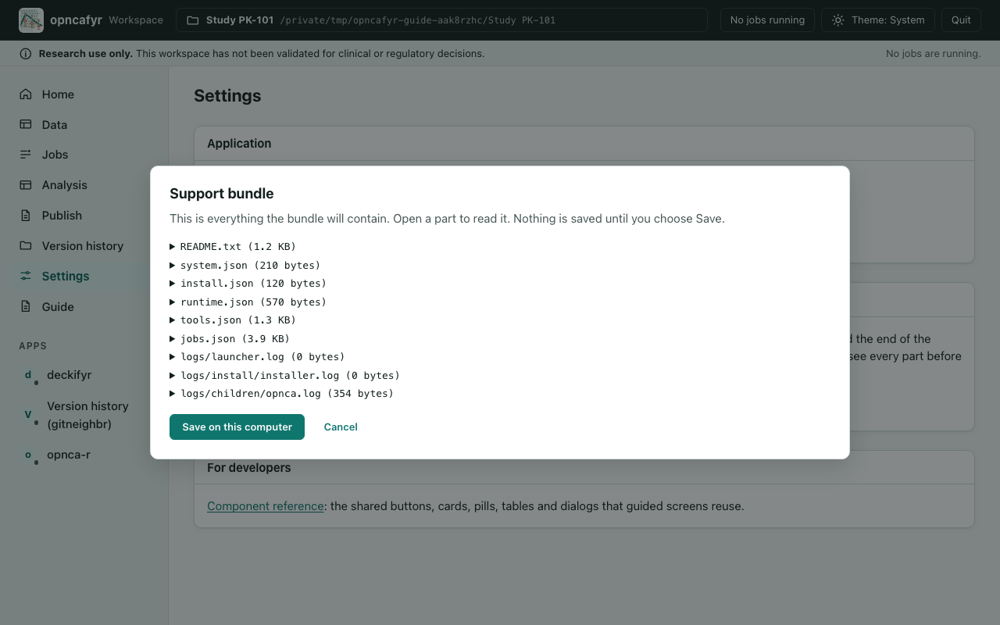

# Troubleshooting and getting help

Most problems show up as a message on the page you are using, or as a failed job. Start there: the app writes its messages for you to read, and they usually say what to do.

## The Linux installer lists missing libraries

On Ubuntu 24.04 the installer checks, before it changes anything, that the system libraries opncafyr needs are installed. It cannot add them without administrator rights. If some are missing it prints their names and the Ubuntu packages to ask for. Send that list to your administrator and run the installer again. The same message appears if the computer is not Ubuntu 24.04 or its C library is older than the installer needs; in that case use the container (see [Running on a cloud computer](cloud-container.md)).

## A tool shows Unavailable

On **Home**, each tool in the **Tools** card shows its health. **Unavailable** means the app could not start or find that tool. The tile shows a short reason underneath.

1. Quit the app and start it again. Tools are checked each time the app starts.
2. If the tool is still **Unavailable**, repair the install: see [Checking and repairing an install](install.md#checking-and-repairing-an-install).
3. If repair does not help, make a support bundle: see [Getting help](#getting-help).

"Slide previews unavailable: LibreOffice is not installed." is not a fault. LibreOffice is optional; without it, decks build without slide previews.

**Version history (gitneighbr)** is optional too. If it shows "The installed runtime has no 'git'", Git wasn't installed, for example because it couldn't be downloaded. The install report says so under **Optional components**. Everything else works without it. To add it later, reinstall: see [Checking and repairing an install](install.md#checking-and-repairing-an-install).

## A job failed

1. Select **Jobs** on the left.
2. Find the job marked **Failed**. Its message says what went wrong.
3. Fix what the message names, then start the job again from the page where you started it.

A failed or cancelled job keeps nothing half-made, so you can always start it again. If the message is unclear, make a support bundle: it includes recent job states and messages, without your data.

If you opened a study folder and the app says unfinished jobs "were marked failed", the app was stopped while they ran. Start them again.

## A check blocks the run

A **Blocking** finding means the data or mapping needs a change before a run can start. The app never fixes these for you.

1. Read the finding's message and hint. The line numbers are lines in the source file; the header is line 1.
2. Change the mapping (card **4. Column mapping**) or add a cleaning step (card **2. Cleaning steps**). [Mapping columns and running checks](mapping-and-checks.md#blocking-findings) lists the usual fixes.
3. If you changed the recipe, select **Apply to all rows** again.
4. Select **Run checks** again.

If **Start analysis** stays greyed out, read the line above it. It says what is left: run the checks, fix blocking findings, acknowledge warnings, or choose all three BLQ rules and the BLQ method.

If the analyte you want shows no rows, check its exact text. `"METAB"` and `"METAB "` are different values. To join them, add a **Replace values** or **Trim spaces** step; that is your decision, and it is recorded.

## opnca-r doesn't open

- **Open in opnca-r** shows only on runs that are **Preparing** or **Running**. A run that has been saved cannot be opened again; make a new run instead.
- While opnca-r starts, the page says "opnca-r is starting. It opens here when it is ready." Wait a moment.
- If the page says "opnca-r is not running", go back to **Analysis** and select **Open in opnca-r** again.
- If opnca-r shows **Stopped unexpectedly**, select **Reload**, or open the run again from **Analysis**.
- If the **Analysis** page shows an error after **Open in opnca-r**, read it, then check opnca-r's health on **Home**.
- If it says the run "was prepared before the launcher passed its unit labels to opnca-r", the run was made by an older version of the app and can't be opened in opnca-r any more. Make a new run: set up cards 5 and 6 again and select **Start analysis**.

## A save or replay does not go through

- If the **Analysis** page says the save failed, the run is **Failed**. Select **New run from this** to try again with the same choices. One reason is a save whose unit labels are not the run's: opnca-r labelled the results in other units.
- If the page says the run "did not replay to the same results", it lists the differences. Select **Replay again**. If it still does not match, the run cannot be completed or published. Make a new run from cards 5 and 6, and make a support bundle so someone can look into it.

## A report render fails

1. Read the message on the **4. Report (DOCX)** card, or the failed job on the **Jobs** page.
2. Select **Check** and fix what it lists. Most render problems show up there first.
3. If you edited the report, look at your last change. Use **Source** in the editor to see the full text.
4. Make sure the study folder is not inside a hidden folder (one whose name starts with a dot). Reports cannot be built there.
5. If the editor has unsaved changes, save or discard them. **Check** and **Render** wait until you do.

A failed render keeps nothing, so you can render again as often as you need. Deck builds work the same way: read the message on the **5. Deck (PPTX)** card and select **Check** first.

## A deck build stops with "unexpected error in the deck tool"

This means the deck tool failed on something it didn't expect, not that your deck is wrong. Nothing is recorded for a failed build. Make a support bundle (see [Getting help](#getting-help)) and include the build's message. Tables with empty cells are not the cause: they build (see [Tables with empty cells](decks.md#tables-with-empty-cells)).

## Version history won't set up, save or send

Version history explains each refusal on its own page, and when it refuses, nothing in the folder has been changed.

- **"This folder is inside a Git project that starts in a folder above it."** The study folder sits inside another Git project, so version history can't tell its files apart. Move the study folder out of it, or ask whoever manages that project.
- **"…a Git setting that isn't supported here…"** or a named file such as `.gitattributes`. The folder's Git project uses Git LFS, an encryption filter, submodules or a setting that would run another program. The page names the setting; ask someone experienced with Git.
- **Saving waits** while a job runs or another editor has unsaved changes. Let the job finish, or save the other editor's work, then try again.
- **"Something changed since the list was shown."** Files changed after the list appeared. Look at the list again and retry.
- **Sending or getting updates fails.** Check that the address starts with `https://` and that the access token is right and still valid. If you are on a company network, check that you can reach the server. Nothing on your computer changes when it fails.

## The app closed by itself

The app closes itself after a time with no open page, to free the computer's memory. It never closes while a job is running or an editor has unsaved changes.

To change the time, go to **Settings** and choose **Close automatically when unused for**: from 5 minutes to 2 hours, or **Never**. The default is 30 minutes.

When the app has stopped, its tab shows a page headed **opncafyr has stopped**. Nothing on the old page works any more. Start the app again from its icon, and close the old tab. Your work is in the study folder, so nothing is lost.

If the tab shows **Connection to opncafyr was lost** instead, the page couldn't reach the app and nothing confirmed that it was quit. It may have been quit from another tab, closed itself after a time with no open page, or stopped unexpectedly. Start it from its icon if it isn't running. If it is still running, select **Check again** and the page reloads.

## Getting help

The person who supports opncafyr at your site may ask for a support bundle. It is a zip file that helps them find out why something went wrong.

### Create a support bundle

1. Go to **Settings**.
2. Under **Support**, select **Create support bundle…**.
3. A window shows every part of the bundle. Open a part to read it. Nothing is saved yet.
4. Select **Save on this computer**, or **Cancel**.
5. The page says where the bundle was saved: in the app's `logs/support` folder. It also lists your recent bundles; select one to download a copy, for example to attach it to an email.



### What it holds, and what it never holds

A support bundle holds:

- the versions of the app and its tools, and your operating system;
- each tool's health;
- the states and short messages of recent jobs in the open study folder;
- the end of the app's logs and of the last install log.

It never holds your data, your results or your file names. Subject identifiers, numbers and your user name are masked in every message.

The bundle stays on your computer. It is never sent anywhere. Send it yourself if you choose to.

### From the command line

If the app will not start, you can make a support bundle from Terminal or PowerShell. The app asks before it saves anything.

On macOS, in Terminal:

```sh
"$HOME/Library/Application Support/opncafyr/current/launcher/bin/python" -m opncafyr doctor --bundle
```

On Windows, in PowerShell:

```powershell
$r="$env:LOCALAPPDATA\opncafyr"; & "$r\versions\$(Get-Content $r\current)\launcher\Scripts\python.exe" -m opncafyr doctor --bundle
```

To see everything first without saving, use `doctor --preview` in place of `doctor --bundle`. To include a study folder's recent jobs, add `--workspace` and the folder, for example `--workspace "$HOME/Documents/TA-walkthrough"`.

### If the install failed

A failed install writes its own bundle, `logs/support/install-failure-<time>.zip`, in the app folder (`~/Library/Application Support/opncafyr` on macOS, `%LOCALAPPDATA%\opncafyr` on Windows). It holds the install logs and step results, with your home folder, user name and any passwords or tokens masked. Send it to the person who supports opncafyr.

### Try a repair

Many install problems are fixed by a repair. See [Checking and repairing an install](install.md#checking-and-repairing-an-install).
