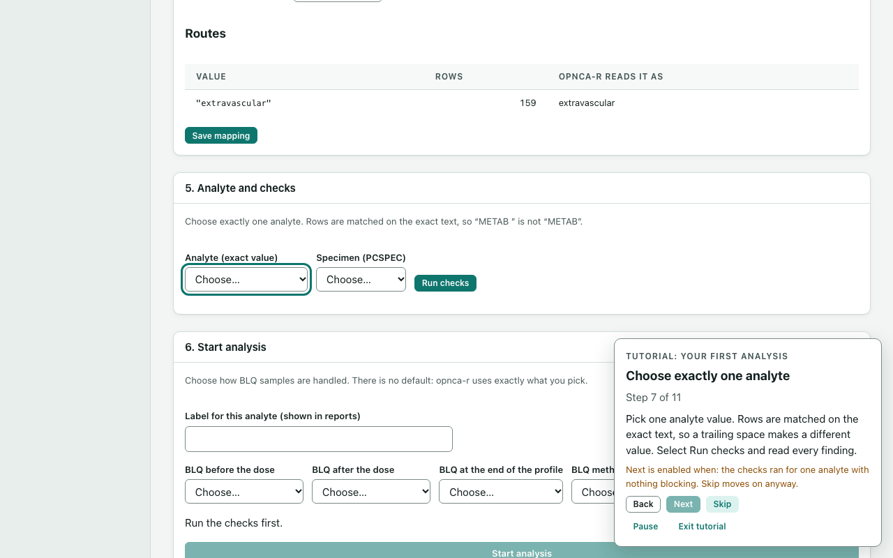

# Tutorials

A tutorial walks you through the app. A panel in the corner of the page says what to do, a ring highlights the control to use, and the tutorial waits for you to do the step. You do every step yourself: a tutorial never clicks, chooses, runs or publishes anything. It is a guide to the screens. Finishing one does not show that an analysis is right.

## Take a tutorial

1. Select **Tutorials** on the left.
2. Select **Start** beside a tutorial. **Your first analysis** goes from a data file to a publication.
3. Read the step in the panel, then do it on the page. The highlighted control has a ring around it, and the page moves to the right screen for you.
4. Select **Next** when you are done. Some steps wait until the page shows the step as done, such as "the study has an imported data file". Until then **Next** is greyed out and the panel says what it waits for. **Skip** always moves on.



The panel also has **Back**, **Pause** and **Exit tutorial**. **Escape** closes the panel too.

- **Pause** removes the highlight and shrinks the panel. **Resume** carries on from the same step.
- **Exit tutorial** closes the panel and keeps your place. **Resume** on the Tutorials page brings it back.
- Your place is saved by the app, not the browser, so it is still there after a reload or the next time you open the app. **Reset progress** forgets it. **Reset all tutorial progress** forgets every tutorial's place.

## When the control isn't there

Some controls appear only after an earlier step. For example, **Import** shows only after a preview. Others may not be in this version of the app. The panel then says the control isn't on the page right now, and offers two ways on:

- **Look again** looks for it once more.
- **Continue without highlight** keeps the directions without the ring.

Inside an app with its own screens, such as opnca-r, the tutorial can't point at controls. It gives directions in the panel instead.

## Write your own

1. Under **Examples**, select **New from example**. The editor opens with a copy of it in place of the list.
2. Give the file a name and change the tutorial, then select **Save as new tutorial**. It is saved as `tutorials/<name>.yaml` in the study folder. Saving never replaces a file.

Select **Edit** beside one of the study's tutorials to change it, or **Edit to fix** beside one that can't be used. The editor works like the [study profile editor](study-profiles.md#edit-a-profile-in-the-app):

- Each step has a title, a step id and the text to show. **Show this view**, **Point at** and **Wait until** are chosen from lists by name, so a tutorial can't name a page, control or condition the app doesn't have. When a step shows a view, **Point at** lists the controls on that view and in the sidebar.
- **Move up**, **Move down** and **Remove** change the order. The editor checks the tutorial as you type, and **Save** writes the file only when nothing is wrong.
- Saving rewrites the file from the form, without comments. It never changes anyone's progress. If you change a tutorial you are part-way through, the panel says it changed when you resume.
- **Quit** asks first while there are unsaved edits.

**Copy into this study** copies an example unchanged, if you would rather edit the file in a text editor. Then select **Check again**. If the file has a mistake, the page lists each problem with the step and field it is in. The editor opens only a well-formed file; a file with a YAML mistake shows its problems instead.

```yaml
schema_version: "1.0"
id: our-first-run          # lower-case letters, digits and dashes
version: "1"
title: Our team's first run
audience: New analysts      # optional
prerequisites:              # optional
  - The study's data file is in source-data.
profile: fed-fasted         # optional: the study profile this goes with
steps:
  - id: mapping
    title: Map the columns
    view: analysis               # optional: the page to show
    target: nca.mapping.card     # optional: the control to highlight
    wait_for: nca.mapping.ready  # optional: Next waits for this
    text: Choose the column for each role, declare the units and save the mapping.
```

Each step needs an `id`, a `title` and plain `text`. It can also name one `view`, one `target` and one `wait_for` condition. Nothing else is allowed: a tutorial has no place for HTML, scripts, web addresses, file paths or commands, and the app refuses a file that tries to add one.

- **Views**: `home`, `data`, `jobs`, `settings`, `guide`, `tutorials`, `profile`, `analysis`, `publish`, `history`.
- **Targets and conditions**: the same names as in a study profile. See [Study profiles](study-profiles.md#targets-and-hints). The left-side links are targets too, such as `shell.nav.data` or `shell.nav.analysis`. So are the jobs list (`shell.jobs.list`) and the bar above an embedded app (`shell.tool.toolstrip`).

A file can be at most 256 kB. Your place in a study's tutorial is kept by its file name. If the file changes, the panel says so and carries on from the same step if it still exists.
