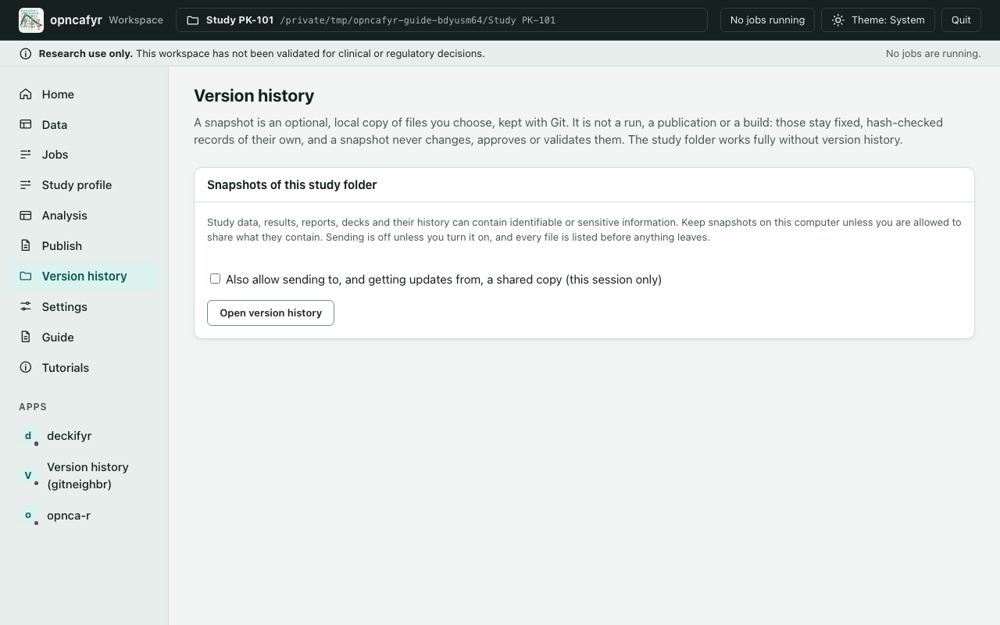
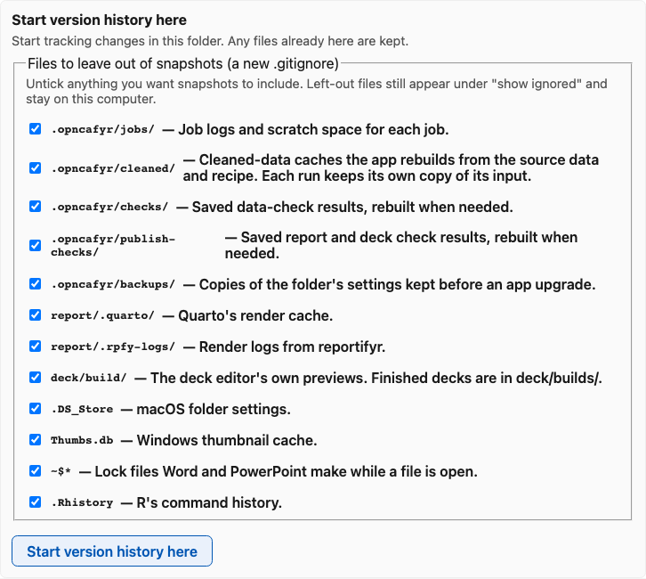
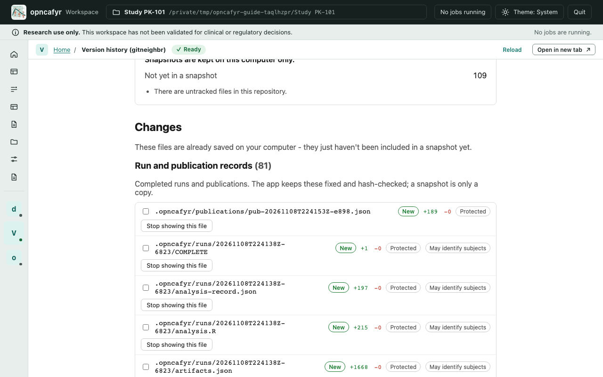
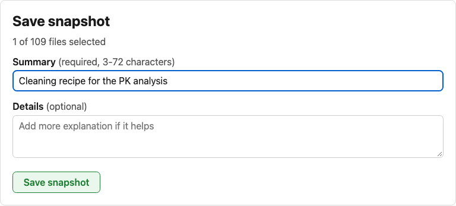

# Version history

> **Research use only.** A snapshot keeps a copy of files. It does not check, approve or validate anything.

Version history keeps optional snapshots of files you choose from your study folder, using Git. You don't need it: the study folder works fully without it.

A snapshot is not a run, a publication or a build. Those stay fixed records of their own, with file fingerprints, and a snapshot never changes them. Getting updates from a shared copy can never replace a completed run, a publication or a build in your folder.

## Open version history

1. Open a study folder. **Version history** appears in the left side once a folder is open.
2. Select **Version history**, then **Open version history**. Leave **Also allow sending…** unticked unless you need it (see [Sending and getting updates](#sending-and-getting-updates)).
3. The version history page opens under **Apps**, as **Version history (gitneighbr)**.

If **Version history** says it is unavailable, its part of the install is missing (for example Git). Everything else in the app keeps working. See [A tool shows Unavailable](troubleshooting.md#a-tool-shows-unavailable).

## Set it up in a folder

The first time, the page says version history isn't set up in this folder yet. Nothing happens until you choose to set it up.

- **Start version history here** sets it up in this folder only.
- It can offer files to leave out of snapshots: ones you don't need to reproduce your results, such as job scratch files, caches the app rebuilds, render logs and the lock files Word makes. Each comes with a reason. Untick any you want to keep. They are written as a new `.gitignore`, and only if the folder doesn't have one yet. Left-out files stay on your computer and still show under "show ignored".
- Before your first snapshot, it asks for your name and email (**Before your first snapshot**), recorded with each snapshot. Select **Save my name and email**. They are kept by the app on this computer, not in the study folder, unless you tick **Just for this project**.

The page refuses, and says why, when:

- **the folder is inside another Git project** that starts in a folder above it. Nothing in either is changed. Move the study folder elsewhere, or ask whoever manages that project.
- **the Git project uses settings the app doesn't support**, such as Git LFS, encryption filters, submodules, or settings that run other programs. The page names the setting so you can ask for help.
- **a different user owns the folder than the one running the app.** This happens in the cloud container when the folder was created by another account, or the container was started without `opncafyr-container`. The app opens version history for exactly the study folder you opened, and no other, so this refusal is now rare; if Git still says it can't open the folder, make the owner match (see [Cloud container](cloud-container.md#files-and-owners)).

## Save a snapshot

1. Under **Changes**, the page lists changed files in groups: **Run and publication records**, **Generated files** (published outputs and builds), **Editable sources** (cleaning recipes, and the report and deck projects you edit), **App working files**, **Source data** and **Other files**. Some carry labels:
   - **Protected:** the app's fixed records. Version history never changes these files in your folder.
   - **May identify subjects:** data, results, outputs, reports and decks that can contain subject-level information.

   

2. Nothing is selected for you. Select each file you want in the snapshot. Select a file's name to see what changed; for binary files you see their size only. On a new file, **Stop showing this file** adds it to `.gitignore`, after asking.
3. Under **Save snapshot**, type a summary, then select **Save snapshot**.

Only the files you selected are saved. Anything else, including what you had already staged with Git yourself, is left as it was. If the folder changed since the list was shown, the snapshot is refused and nothing is saved; look again and retry.

While a job is running, or another editor has unsaved changes, saving waits: the page says why. Finish or save that work first.

## Sending and getting updates

Sending copies snapshots, and every file in them, to another computer, such as a company Git server. Study data and results can be identifiable, so:

- Sending is off unless you tick **Also allow sending to, and getting updates from, a shared copy** before opening version history. It lasts for that session only.
- Only HTTPS addresses (`https://…`) are supported. Paste an access token when asked; it is kept until the page closes and is never saved.
- Nothing is sent or fetched until you select **Check what would be sent** or **Check for updates**.

**Check what would be sent** lists every snapshot that would leave, not just the latest, and every file in each, with sizes. Files marked **May identify subjects** need a second confirmation. Leaving a file out of a new snapshot doesn't remove it from earlier ones: if it was in an earlier snapshot, it is in the list. **Send these snapshots** sends exactly what was listed. If anything changed in between, it refuses and asks you to check again.

**Check for updates** lists the snapshots that would arrive and the files they would change. Updates are refused when they would change a protected file, or a file with changes on this computer that aren't in a snapshot. They are also refused when your work and the shared copy have each changed. In that case nothing is changed, and the page explains what to do.

If sending fails because the access token was refused, the network is down or the shared copy changed, nothing on your computer changes. Check the token or the connection and try again.

## Close version history

Select **Close version history** on the **Version history** page, or **Quit**. Changing to another study folder closes it too, so it never shows the previous folder.
